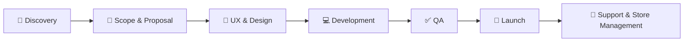

<!-- Header -->

  

  

  
  
  
  

  
  
  

---

## 👋 About me

I'm **Vivek Rathod**, a **Senior Shopify Developer** and **Shopify Department Lead** based in **Surat, Gujarat, India**.
I build custom Shopify themes and apps for brands worldwide, and handle **scope → build → launch → ongoing store management** myself.

- 🛍️ Custom Shopify **stores** and **apps** (public & private)
- ⚡ Speed, Core Web Vitals & conversion optimisation
- 🔁 Migrations from WooCommerce, WordPress & custom platforms
- 🔌 Integrations with ERP, payments, shipping & WhatsApp
- 🧭 Developer **and** manager — I understand business goals, not only code
- 💬 Ask me about **Liquid, Shopify Functions, Checkout Extensibility, Metaobjects**

  
  
  

---

## 🛠️ Tech stack

  
  
  
  
  
  
  

  

<b>🔍 Full Shopify toolkit</b>

 

| Area | Tools |
|---|---|
| **Themes** | Liquid · Online Store 2.0 · Theme architecture · Metafields · Metaobjects · Theme app extensions |
| **Apps** | App development · Admin GraphQL API · Storefront GraphQL API · Webhooks · Shopify CLI |
| **Checkout** | Shopify Functions · Checkout extensibility · Checkout extensions |
| **Front end** | HTML · CSS · JavaScript |
| **Other platforms** | WordPress · Custom ERP integration |
| **Management** | Project management · Store management · Product management · Client communication |

---

## 💼 Experience

| Role | Company | Period |
|---|---|---|
| 🧭 **Shopify Department Manager** | LKR Code Orbit · Remote | Sep 2026 – Present |
| 🚀 **Senior Shopify Developer** | ITCODE Infotech · Surat | Jul 2026 – Present |
| 💻 **Senior Shopify Developer** | Trignix InfoTech · Surat | Jul 2025 – Jun 2026 |
| 📦 **Product Manager** | Shopperstrend · Surat | Feb 2025 – Jun 2025 |
| 🛍️ **Shopify Developer** | Shopperstrend · Surat | Nov 2024 – Feb 2025 |

---

## 🏪 Featured stores

  
  
  
  
  
  

<a href="https://rathodvivek.in"><b>➡️ See all 33 stores on rathodvivek.in</b></a>

---

## 🧩 How I work

---

## 📊 GitHub stats

  
  

  

  <picture>
    <source media="(prefers-color-scheme: dark)" srcset="https://raw.githubusercontent.com/vivekrathod4909/vivekrathod4909/output/github-snake-dark.svg" />
    
  </picture>

---

  

